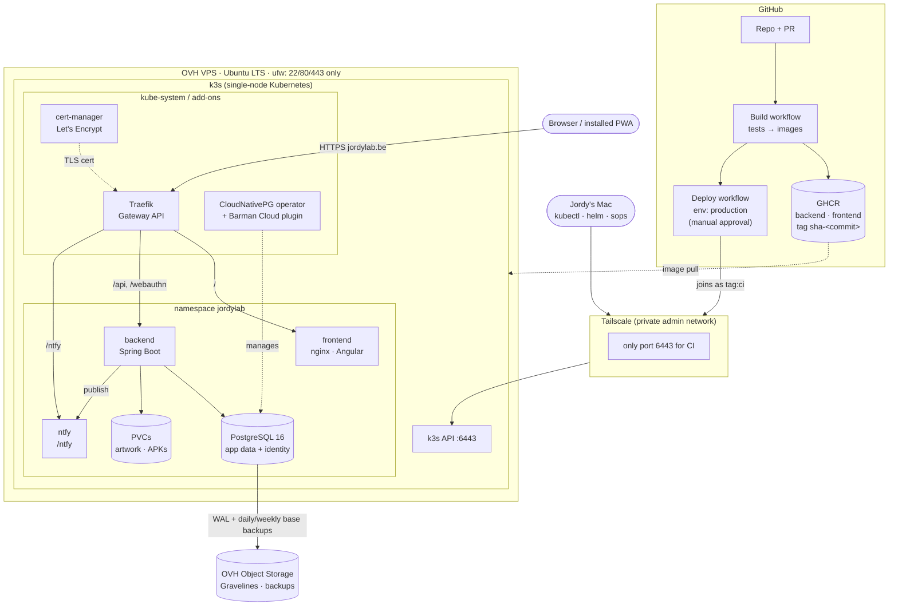

# JordyLab

Personal platform for financial intelligence, health/fitness tracking, game cataloging, and
recipe management — a modular monolith with a separate frontend and Python sidecar. See
`AGENTS.md` for the full architecture and module overview.

## Architecture

Production runs on a single OVH VPS with k3s at **https://jordylab.be**. Local development runs the same
pieces with Podman Compose (see below). How production was built: [
`docs/runbooks/vps-k3s-deployment`](docs/runbooks/vps-k3s-deployment/README.md);
day-to-day operations: the `jordylab-devops` agent (`.claude/agents/`, `.opencode/agents/`).



## Running locally

Two local services run together with the apps: Postgres + pgvector (via Podman Compose) and the
Spring Boot backend; the Angular frontend talks to it with a normal session cookie. Authentication is
built into the backend (passwords + passkeys) — there is no identity container.

### Prerequisites

- Java 25, Gradle Wrapper (bundled — `./gradlew`)
- [Bun](https://bun.sh) (`bunx nx ...` runs everything frontend-side — never `npm`/`npx`/`yarn`)
- [Podman](https://podman.io) + Podman Compose (the compose files are runtime-agnostic, so
  Docker + Docker Compose work the same way if you prefer them)

### 1. Configure environment variables

Create `jordylab-be/.env` (git-ignored, never committed):

```bash
POSTGRES_USER=jordylab
POSTGRES_PASSWORD=<any local dev password>
GAMECATALOG_ARTWORK_DIR=/tmp/jordylab-artwork   # a real path — doesn't need to exist yet
ANTHROPIC_API_KEY=<your Anthropic API key>       # required for AI-backed features (FNA
                                                  # briefings, gamecatalog chat/enrichment)
```

These are local bootstrap credentials for the containers below — not production secrets.

### 2. Start Postgres

```bash
cd jordylab-be
podman compose up -d
```

This starts `pgvector/pgvector:pg16` on `localhost:5432`. The `identity` tables (accounts, passkeys,
sessions, machine tokens) are created by Flyway on the backend's first start; there is no identity
container to run.

### 3. Start the backend

```bash
cd jordylab-be
set -a && source .env && set +a
SPRING_PROFILES_ACTIVE=local ./gradlew bootRun
```

Runs on `http://localhost:8080` and authenticates against its own `identity` tables. On a fresh database
the `local` profile creates the admin **jordy** with the dev-only password
`local-dev-admin-password-not-for-prod` (change it in Account settings; it is never used in production).
The `local` profile is required: without it the backend stops immediately with
*"No valid Spring profile is active"*.

### 3b. Run the backend tests

Tests boot Postgres via Testcontainers, which needs to find the Podman machine socket:

```bash
export DOCKER_HOST=unix://$(podman machine inspect --format '{{.ConnectionInfo.PodmanSocket.Path}}')
export TESTCONTAINERS_RYUK_DISABLED=true   # ryuk needs privileges the Podman socket may not grant
cd jordylab-be && ./gradlew build
```

Give the Podman machine at least 6 GiB of memory (`podman machine stop && podman machine set --memory 6144 &&
podman machine start`): with the default 2 GiB, the later test classes that start their own Postgres
containers fail with `localhost:2375 failed to respond`.

### 4. Start the frontend

```bash
cd jordylab-fe
bun install
bunx nx serve jordylab            # host app, http://localhost:4200 — lazy-loads fna + gamecatalog
```

Or run a single domain standalone, without the host shell (it uses the same session authentication):

```bash
bunx nx serve fna                 # http://localhost:4300
bunx nx serve gamecatalog         # http://localhost:4400
```

### 5. Your own local account

Register at http://localhost:4200. New accounts are `PENDING` and land on "awaiting approval". Sign in as
**jordy** and approve the new account in Settings → Users (approval grants the `guest` role and Game Catalog
access). There is only one admin, so roles are not edited from the panel.

Forgot the local password? Use the admin-approved reset on `/forgot-password`, or the break-glass procedure in
`docs/runbook.md` §24. The scan client uses a per-machine token from Settings → Machines, not a password.

### Ports at a glance

| Service | Port |
|---|---|
| Backend API | 8080 |
| Postgres | 5432 |
| Frontend host (`jordylab`) | 4200 |
| `fna` standalone harness | 4300 |
| `gamecatalog` standalone harness | 4400 |

## Repository structure

See `AGENTS.md` for the module breakdown, AI routing, and infrastructure notes. Sub-project
conventions live in each subdirectory's own `AGENTS.md` (`jordylab-be`, `jordylab-fe`,
`garmin-sync-service`).

## Licence

This repository is public so the code can be read, but it isn't open source: all rights are
reserved. You're welcome to look around, but copying, modifying, or reusing any part of it
requires my permission first. See [`LICENSE`](LICENSE) for the exact terms, and get in touch with
me (Jordy Swinnen) if you'd like to use something here.
